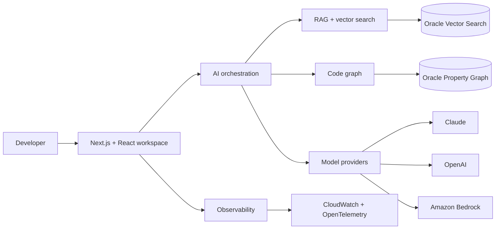

 

  

 

 

<table align="center">
<tr>
<td align="center" width="180"><b>3+ YEARS</b> Professional Experience</td>
<td align="center" width="180"><b>MERN</b> Primary Stack</td>
<td align="center" width="180"><b>AI + LLM</b> Engineering Focus</td>
<td align="center" width="180"><b>ENTERPRISE</b> Product Experience</td>
</tr>
</table>

## ⚡ About me

I’m **Dikshant Chitara**, a Full Stack Software Engineer focused on **MERN application development, AI engineering, backend architecture, and distributed systems**.

I build enterprise applications, real-time platforms, developer tools, and AI-powered workflows across frontend, backend, data, cloud, and observability layers.

| 🧭 Primary identity | 🛠️ Engineering mindset | 🎯 Current direction |
|:---:|:---:|:---:|
| Full Stack Software Engineer | Practical, observable, scalable systems | Code intelligence + AI platforms |

## 🏢 Professional journey

<table>
<tr>
<td width="24%" align="center">

  <b>SpanIdea Systems</b> 
Software Engineer
</td>
<td>
<b>Nokia 3D Digital Twin</b> — Building network visualization and monitoring experiences with React.js, Node.js, CesiumJS, WebGL, 3D Tiles, MQTT, and InfluxDB.  
<b>Nokia MPLS & Network Management</b> — Working across OpenWrt, LuCI, Lua, Linux, FRR, and network operations workflows.  
<b>Codebase Intelligence</b> — Developing AI-powered code understanding, documentation, retrieval, and navigation capabilities.
</td>
</tr>
<tr>
<td width="24%" align="center">

  <b>Kanini Software Solutions</b> 
Software Engineer
</td>
<td>
<b>Medtronic Messaging Platform</b> — Contributing to lead-generation and messaging workflows using Node.js, PostgreSQL, Redis, Kafka, Meta WhatsApp Cloud API, and AI integrations.  
<b>JOBEZE</b> — Building recruitment workflows with React.js, Node.js, Express.js, SQL, RabbitMQ, and Redis.  
<b>Kanini Academy</b> — Contributing to an e-learning platform with React.js, Node.js, MongoDB, and REST APIs.
</td>
</tr>
</table>

## 🧠 Current flagship project

### AI-powered code understanding for complex software systems

Codebase Intelligence is an enterprise platform for **understanding, analyzing, documenting, and navigating large codebases**. It uses **CodeWiki** as its primary code-understanding and documentation engine and combines retrieval, graph relationships, AI orchestration, and production infrastructure.

<table>
<tr>
<td valign="top" width="50%">
<h4>🎨 Product experience</h4>

Next.js · React · TypeScript · Tailwind CSS · shadcn/ui · Framer Motion · React Flow · Monaco Editor · TanStack Query · Zustand
</td>
<td valign="top" width="50%">
<h4>🤖 AI & backend</h4>

Python · FastAPI · LangGraph · Claude · OpenAI · Gemini · Amazon Bedrock · custom AI orchestration
</td>
</tr>
<tr>
<td valign="top">
<h4>🗄️ Data & infrastructure</h4>

Oracle Database 26ai · Oracle Vector Search · Oracle Property Graph · Redis · S3 · Arq · AWS ECS · Terraform · AWS Secrets Manager
</td>
<td valign="top">
<h4>🔍 Quality & observability</h4>

OpenTelemetry · CloudWatch · Pytest · Vitest · Playwright
</td>
</tr>
</table>

## 🧰 Technical toolbox

<h4>Languages & application development</h4>

<h4>Data, cloud & systems</h4>

<b>View complete capability map</b>

<table>
<tr><td><b>Frontend</b></td><td>React.js · Next.js · Angular · HTML5 · CSS · Tailwind CSS · Material UI · Ant Design</td></tr>
<tr><td><b>Backend</b></td><td>Node.js · Express.js · REST APIs · Microservices · WebSockets · Event-Driven Architecture</td></tr>
<tr><td><b>Data & messaging</b></td><td>MongoDB · PostgreSQL · Redis · InfluxDB · Oracle · Kafka · RabbitMQ</td></tr>
<tr><td><b>AI & LLM</b></td><td>OpenAI API · Gemini API · Claude · LangChain · LangGraph · RAG · Vector Search · AI Agents · Prompt Engineering</td></tr>
<tr><td><b>Cloud & DevOps</b></td><td>AWS · Docker · Linux · CI/CD · Terraform · Google Cloud Functions · Google Container Registry</td></tr>
<tr><td><b>Networking</b></td><td>OpenWrt · LuCI · MQTT · FRR · MPLS · Network Monitoring · Linux Networking</td></tr>
<tr><td><b>Practices</b></td><td>System Design · API Security · Testing · Agile · Scrum · Debugging · Performance Optimization · Code Reviews</td></tr>
</table>

## 🚀 Selected work

<table>
<tr>
<td width="50%" valign="top">
<h3>🧑‍💻 CodePilot AI</h3>

 AI-assisted browser development environment with file exploration, Monaco editing, terminal interactions, WebSockets, and AI code processing.
</td>
<td width="50%" valign="top">
<h3>📄 Smart Resume Customizer</h3>

 AI-powered LaTeX resume optimization with keyword matching, version comparison, PDF preview, templates, and cover-letter generation.
</td>
</tr>
<tr>
<td valign="top">
<h3>🧠 LeetCode Daily AI</h3>

 Python and GitHub Actions automation that generates, validates, and stores daily algorithm solutions for human review.
</td>
<td valign="top">
<h3>💬 React Messaging App</h3>

 Real-time text and file messaging proof of concept built with React, Node.js, and WebSockets.
</td>
</tr>
</table>

## 🎓 Education

<table align="center">
<tr>
<td align="center" width="50%">

  <b>Master of Computer Applications</b> 
Artificial Intelligence & Machine Learning 
<b>JECRC University, Jaipur</b> 
2021 – 2023 · <b>8.5 GPA</b>
</td>
<td align="center" width="50%">

  Enterprise applications 
AI-powered developer tools 
Backend and distributed systems 
Continuous engineering growth
</td>
</tr>
</table>

## 🌐 Engineering signals

## 📊 Engineering activity

  

  

  

## 🤝 Let’s connect

 

  

  

